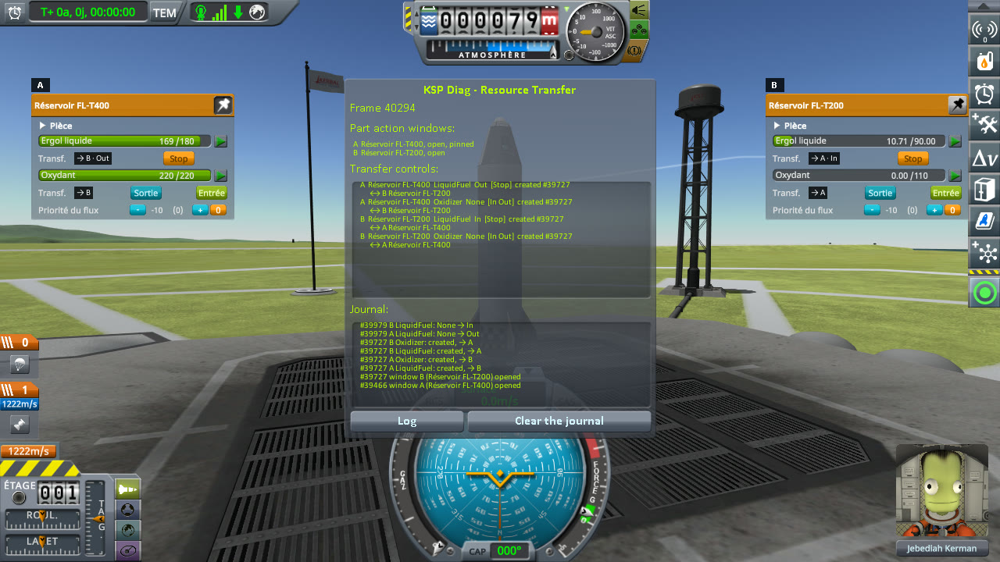

# KSP Diag - Resource Transfer

**⚠️ Work in progress.** This is an active investigation, not a finished mod. The code and this page can still change, and several questions are still open.

A viewing instrument for KSP 1.12. In flight, it shows how the part action windows pair their resource
transfer controls, the In, Out and Stop buttons under each resource of a tank: which window each control
is paired with, in what state it is, and when it appeared. It marks each part action window with a letter,
puts a badge on each transfer control with the letters of the windows of its targets, and lists every
control in a small window of its own, with a journal of what changes.

**How this was made.** Written with Claude, Anthropic's AI assistant, and reviewed by a human — me. I am
saying so up front, because contributions made with an AI deserve a closer look than others, and because
some people would rather stop reading here. That look is easy to give here: this mod changes nothing in
the game, it only reads the windows and controls the game already holds, and the source is about eight
hundred lines with no dependency of any kind.

## What it shows

*Stock KSP 1.12.5 with KSP Community Fixes, in French (Sortie is Out, Entrée is In, Ergol liquide is liquid
fuel, Oxydant oxidizer): the window of an FL-T400 tank pinned on the left, the window of an FL-T200 opened
on the right, two seconds after In was pressed under the FL-T200's liquid fuel.*

**A letter for each part action window.** A, B, C… above the top left corner of each open window. A window
gets its letter the first time the mod sees it, and keeps it for as long as it exists: KSP keeps a window
it closes, hidden, and shows it again when its part is right-clicked.

**A badge on each transfer control.** Between the row's label and its buttons: `→` then the letters of the
windows of the controls it is paired with, its targets. A letter in brackets is a window that is closed,
`†` a target that no longer exists, `—` no target at all. Past five targets, the badge says how many more
there are. While the control sends or takes, its state follows: `· Out` or `· In`.

Badges are drawn only on the controls of open windows. The controls of a closed window are listed in the
window of the mod.

## The window

The window opens at the top right of the screen and can be dragged. `Alt+F6` hides it, and shows it again;
the letters, the badges and the journal go on.

- **The frame** the game is at, as Unity counts them.
- **The part action windows**, by letter and part, open or closed, pinned or not.
- **The transfer controls**, one per line: the letter of its window, its part, its resource, its state
  (`None`, `In` or `Out`), the buttons it shows, and the frame it was first seen on. Under each, its
  targets, one per line: `↔` when the target has the control among its own targets too, `→` when it does
  not; the letter of the target's window and its part, `(closed)` when that window is closed; or
  `(destroyed)`, or `no target`.
- **The journal**, newest line first, each with its frame: a window opened, closed or destroyed; a control
  created, with its targets; a control's state changing; its targets changing; a control destroyed. It
  keeps the last 500 lines.
- **Log** writes to `KSP.log` what the window shows, then the whole journal. **Clear the journal** empties
  it.

The mod writes nothing to `KSP.log` but what *Log* asks.

## What it reads

At the end of every frame, once every script of the game has updated, the mod reads the windows of the
controller of part action windows (`UIPartActionController`): the open ones, and the hidden ones it keeps.
In each, it reads the items that are transfer controls (`UIPartActionResourceTransfer`), and for each
control its state, its buttons and the list of its targets, as the game holds them.

The frame a control is first seen on is the frame at the end of which the mod found it. Two controls seen
on the same frame may still have been created at two different moments of that frame: the mod cannot tell
in what order things happened within a frame. A window opened by a click of the mouse is set up after the
other scripts of that frame have run; a window opened by another mod may be set up before or after.

The journal compares what the mod read at the end of a frame with what it read at the end of the one
before: a change that comes and goes within a frame does not show.

## Taking a reading

Open the part action windows you want to look at, as you would to move a resource: right-click the parts,
pin the windows you want to keep open. Read the badges, then the window: which controls are paired with
which, whether each pairing goes both ways, and when each control appeared. Press a button of a transfer,
or open and close windows, and read the journal: the newest line is at the top. *Log* keeps a reading in
`KSP.log`, *Clear the journal* starts a new one.

A few things to keep in mind while reading, for instance:

- **A right click on a part without the modifier key closes the windows that are not pinned.** The window
  is hidden, not destroyed: its controls keep their targets, and those that point to it show it in
  brackets.
- **With fewer than two windows open, or with a window open on a part that does not hold a resource, no
  window shows transfer controls for that resource**: KSP takes them away, and builds them again when they
  can show.
- **The letters are the mod's**, not the game's: they follow the order the windows were first seen in, and
  start again from A at every flight scene.

## Driving it by script

With [KSP-Util-MCPServer](https://github.com/lhervier/KSP-Util-MCPServer) installed next to it, this mod
offers its window to a program, as tools of that server: a script presses its buttons and reads what it
shows, as a player would. Without the server, this mod runs the same.

| tool | what it does |
|---|---|
| `resourcetransfer_read` | reads what the window and the badges show, without writing anything: the frame, the windows with their letter, part, open and pinned, every transfer control with its window's letter, part, resource, state, buttons, the frame it was first seen on and its badge, its targets each with its window's letter, part, whether that window is open, whether the target is destroyed and whether the pairing goes both ways, and the journal |
| `resourcetransfer_log` | presses *Log*: writes to `KSP.log` what the window shows, then the journal; returns how many lines it wrote |
| `resourcetransfer_clear_journal` | presses *Clear the journal* |
| `resourcetransfer_move_window` | moves the window, as dragging it does: `x` and `y` in pixels from the top left corner of the screen; returns its position and size |
| `resourcetransfer_show_window` | shows or hides the window, as `Alt+F6` does; the letters, the badges and the journal go on either way |

## Get it

**Compile it** — clone this repository, set `KSPDIR` to your KSP install folder and run `build.bat`. It
needs the .NET SDK and [KSP-Util-MCPServer](https://github.com/lhervier/KSP-Util-MCPServer) installed in
that KSP, takes a few seconds, reads the KSP assemblies straight from your install, and puts the DLL in
`GameData/KSPDiagResourceTransfer/` inside the repository. It does not install anything.
KSP-Util-MCPServer is only needed to compile: it provides the attribute that marks what this mod offers to
it, and this mod runs the same without it.

## Install

Drop `GameData/KSPDiagResourceTransfer` into the `GameData` of KSP, so that you end up with
`GameData/KSPDiagResourceTransfer/KSPDiagResourceTransfer.dll`. It runs on a stock install: no Harmony, no
ModuleManager, no dependency of any kind.

The letters, the badges and the window are there in every flight. The mod reads the part action windows and
writes nothing; your saves are never touched. Removing the folder removes the mod.

## License

MIT
